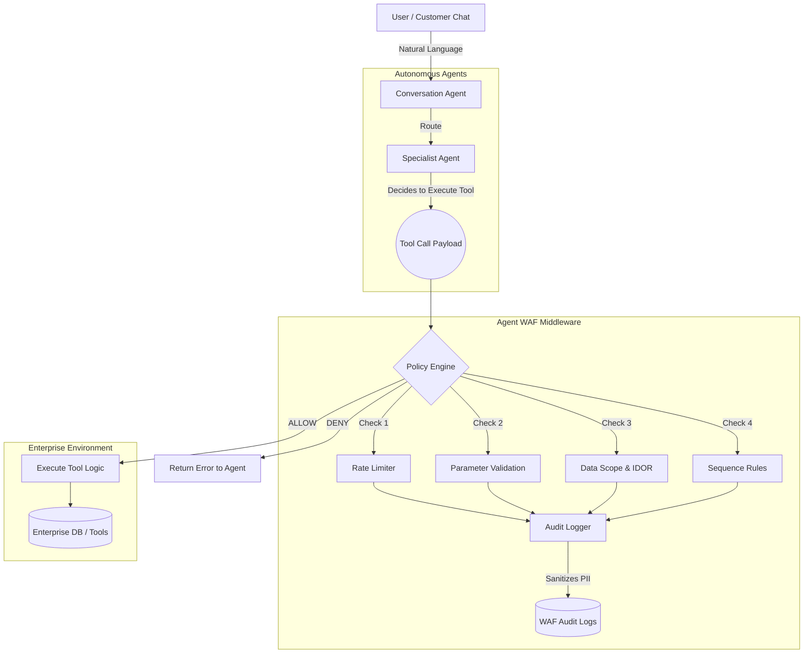

# 1. Problem Statement

## The Context
Traditional Web Application Firewalls (WAFs) sit between the internet and a web server, inspecting and filtering requests before they reach the application. They are essential for protecting traditional software from injection attacks, rate abuse, and unauthorized access. 

However, in the era of autonomous AI agents, a critical security gap exists: **there is no equivalent firewall for agent tool calls.** An autonomous agent can invoke any tool it has a connection to, with any parameters, and with virtually no inspection layer between its decision-making engine and the tool's execution environment. 

## The Challenge
The objective is to build an **Agent WAF** — a policy-enforcing proxy sitting strictly between an AI agent and its enterprise tools. It must inspect, filter, and log every tool invocation in real-time, preventing destructive actions, hallucinated parameters, and data scope violations before they affect internal systems.

---

# 2. The Solution: Agent Sentinel

**Agent Sentinel** is a production-oriented AI Governance Middleware that implements the Agent WAF pattern. It provides a transparent proxy layer intercepting all tool calls made by our suite of sample specialist agents. 

Rather than relying purely on prompt-engineering or post-generation text filtering, Agent Sentinel operates at the **action layer** — the exact moment an LLM attempts to execute a function.

## Key Capabilities
- **Transparent Interception:** Agents make tool calls normally; the WAF intercepts the JSON payload, evaluates it, and either allows the execution, blocks it, or flags it for human review.
- **YAML-Based Policy Engine:** Rules are decoupled from code, allowing security teams to update governance policies dynamically.
- **Shadow Mode:** New policies can be tested in "shadow mode," where the WAF logs what it *would* have blocked without actually interrupting the workflow, allowing for safe calibration.
- **Sanitized Audit Logging:** Every intercepted call is logged with a timestamp, agent ID, tool name, rule evaluation outcome, and a sanitized version of the parameters (stripping PII like SSNs and credit cards).

---

# 3. Architecture Diagrams

The following architecture demonstrates how the WAF sits between the agent's reasoning layer and the enterprise database.

---

# 4. The Rule Engine Implementation

Agent Sentinel implements the required core rule types using a modular Python evaluation engine:

1. **Rate Limiting:** 
   - *Requirement:* Agent may call Tool X no more than N times per minute.
   - *Implementation:* Enforced via a sliding time window in MongoDB. If a session attempts to loop (e.g., endlessly probing an order status), the WAF blocks the execution and informs the agent to stop trying.
   
2. **Parameter Validation:**
   - *Requirement:* Reject calls where parameter values match a blocklist or exceed size limits.
   - *Implementation:* Uses Regex pattern matching and payload sizing. For example, order IDs are strictly validated (`^ORD[\-]?\d+$`). Simulated prompt injections or malformed arguments are caught before database lookup.

3. **Data Scope Enforcement (IDOR Protection):**
   - *Requirement:* Reject calls that reference data outside the agent's declared scope.
   - *Implementation:* The WAF extracts the authenticated user's session context and compares it to the tool arguments. If User A's session attempts to run `cancel_order(order_id="User_B_Order")`, the WAF throws a Data Scope Violation, preventing Insecure Direct Object Reference (IDOR) attacks.

4. **Sequence Rules:**
   - *Requirement:* Reject calls to Tool B unless Tool A was called first in this session.
   - *Implementation:* Enforces workflow integrity. For example, an agent cannot invoke `escalate_to_admin()` for a replacement without first successfully invoking `check_warranty()` and `check_inventory()`.

---

# 5. Market Differentiation

How does Agent Sentinel compare to existing solutions in the AI Security market?

### Traditional WAFs (Cloudflare, AWS WAF)
- **The Gap:** Traditional WAFs inspect HTTP traffic (headers, SQLi, XSS). They have no context of an LLM's internal tool-calling schema.
- **Our Edge:** Agent Sentinel parses OpenAI-style/Groq JSON function arguments natively, understanding the semantic intent of the tool execution.

### Prompt/Output Guardrails (NeMo Guardrails, Lakera, Llama Guard)
- **The Gap:** These tools focus on semantic text filtering (e.g., stopping jailbreaks, toxicity, or prompt injections in the chat). They attempt to secure the *reasoning* layer.
- **Our Edge:** Agent Sentinel secures the *action* layer. Even if an LLM is successfully jailbroken or hallucinates a reason, the WAF proxy prevents the catastrophic action (like dropping a table or refunding a wrong order) by enforcing rigid, deterministic business rules.

### AI Proxy Firewalls (Helicone, Portkey)
- **The Gap:** These proxy the connection between your backend and the LLM API provider (OpenAI/Anthropic) for logging and cost tracking.
- **Our Edge:** Agent Sentinel sits between the LLM backend and *your internal databases*. It governs the tools themselves, rather than the generation of the text.

---

# 6. Success Criteria Validation

All required tasks and success criteria have been successfully achieved:

- [X] **Transparent Proxy Layer:** Intercepts all tool calls from the AI agents.
- [X] **Rate Limit enforcement:** Rapid, repetitive tool invocations are successfully blocked (e.g., max 5 per 60s).
- [X] **Parameter Blocklist/Validation:** Regex restrictions prevent injection attempts and malformed inputs (e.g., enforcing valid Order ID patterns).
- [X] **Out-of-scope Data Access:** Data Scope constraints successfully detect and block IDOR attempts (e.g., attempting to access a different user's order).
- [X] **Sequence Rule Enforcement:** State transition rules block actions like cancelling an already-shipped order, and duplicate detection blocks redundant support ticket creation.
- [X] **Sanitized Audit Logging:** The `waf_audit_logs` collection securely redacts PII (like SSNs and credit cards) before persisting logs, capturing the timestamp, agent ID, and final disposition.
- [X] **Real-time Dashboard:** A React-based Admin Dashboard natively visualizes tool traffic, blocks, and session transcripts.
- [X] **Bonus - Shadow Mode:** Policies can be configured with `shadow_mode: true` to log theoretical blocks without interrupting real workflow execution.

---

**Conclusion:** Agent Sentinel successfully bridges the security gap in autonomous agent architectures, providing deterministic, highly observable governance over non-deterministic AI actions.
